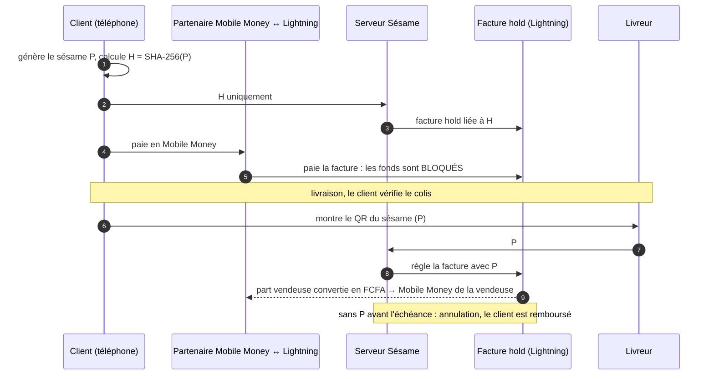

# Sésame

**Le paiement à la livraison, sans cash et sans fausse capture d'écran.**

Au Sénégal comme au Bénin, on vend sur WhatsApp, Instagram et TikTok, mais personne ne se fait confiance : le client refuse de payer d'avance, la vendeuse reçoit de fausses captures de paiement et des commandes annulées à la porte, le livreur transporte du cash. Sésame règle ça : **le client paie avant la livraison (en Mobile Money), l'argent reste bloqué, et il n'est libéré que lorsque le client, colis en main, montre son « sésame » au livreur.** Sans livraison, il est remboursé automatiquement.

En arrière-plan, le blocage est garanti par une **facture hold du réseau Bitcoin Lightning** : pendant la livraison, personne ne peut prendre l'argent, pas même Sésame.

> Projet soumis au **Dakar Bitcoin Hack 2026 by BTrust**.
> **Démo en ligne :** https://sesame-1j54.onrender.com (bouton « Essayer les 3 rôles en 2 minutes », sans compte). Hébergement gratuit : le premier chargement peut prendre une minute.

## Qui fait quoi

| Acteur | Ce qu'il fait | Compte ? |
|---|---|---|
| **Vendeuse** | Colle la conversation WhatsApp (la commande se remplit seule), envoie le lien de paiement, puis la mission au livreur. Reçoit son argent en Mobile Money à la livraison. | Oui (boutique + PIN) |
| **Client** | Ouvre le lien, paie en Mobile Money (ou wallet Lightning). À la livraison, vérifie le colis puis montre son sésame. | Non : un lien WhatsApp |
| **Livreur** | Ouvre le lien de mission, voit que le client a déjà payé, scanne le sésame, reçoit sa course aussitôt. | Non : un lien WhatsApp |
| **Administrateur** | Suit l'activité, les alertes et le journal d'audit ; peut suspendre une boutique. **Ne peut jamais toucher à l'argent.** | Code d'accès |

## Comment ça marche



Détails : [docs/ARCHITECTURE.md](docs/ARCHITECTURE.md).

## Lancer en une commande

Prérequis : **Node.js 22.13+** (aucun Docker, aucune base de données à installer).

```bash
npm run demo        # installe, compile, démarre sur http://127.0.0.1:8080 (mode simulation)
```

Données de démonstration incluses :
- **Parcours complet guidé :** page d'accueil, bouton « Essayer les 3 rôles » (boutique jetable, aucun compte).
- **Espace vendeuse :** `/v`, boutique `pagnes-de-fifame`, PIN `2026` (modifiable via `SESAME_DEMO_PIN`).
- **Réputation publique vérifiable :** `/verify/pagnes-de-fifame`.
- **Administration :** `/admin`, activée en définissant `SESAME_ADMIN_CODE` (8 caractères min.).

Autres commandes : `npm test` (114 tests), `npm run typecheck`, `npm run dev:server` + `npm run dev:web`. Configuration : [.env.example](.env.example). Mise en ligne gratuite : [docs/DEPLOIEMENT.md](docs/DEPLOIEMENT.md).

## État d'avancement (honnête)

| Composant | État |
|---|---|
| Protocole sésame (P/H), montants FCFA ↔ msat, machine à états, moteur de séquestre | ✅ testé |
| API, temps réel (SSE), SQLite (secrets chiffrés), journal d'audit chaîné | ✅ testé |
| Application web mobile : vendeuse, client, livreur, démo guidée, administration | ✅ parcours complet vérifié (360 et 412 px) |
| Reçus Nostr signés + page de réputation vérifiée dans le navigateur | ✅ testé |
| Remplissage de commande depuis une conversation (règles locales, LLM gratuit optionnel) | ✅ testé |
| Paiement Mobile Money et versement vendeuse | 🟡 **simulés** (partenaire visé : Banxaas, pas d'API publique à ce jour) |
| Facture hold Lightning | 🟡 **wallet simulé** dans la démo ; adaptateur LND (réseau de test) en cours |

Tout ce qui est simulé est signalé à l'écran par un bandeau « Démonstration ».

## Contraintes et limites connues

- **Conversion Mobile Money ↔ bitcoin :** elle exige un partenaire agréé dans chaque pays de l'UEMOA. Sésame ne la fait pas lui-même. Banxaas couvre le Sénégal, la Côte d'Ivoire, le Cameroun et la Guinée, **pas encore le Bénin**.
- **Qui reçoit les sats à la libération :** idéalement le partenaire lui-même (Sésame ne touche alors jamais l'argent). À défaut, un nœud Sésame les reçoit quelques secondes avant le versement Mobile Money, ce qui demanderait un cadre réglementaire. Voir [ARCHITECTURE](docs/ARCHITECTURE.md#qui-recoit-les-sats).
- **Durée de blocage :** une facture hold immobilise de la liquidité Lightning ; le délai de livraison est donc limité à 12 h.
- **Litiges après livraison** (produit défectueux) : non couverts en V1, le client vérifie avant de donner son sésame.
- **Hébergement gratuit (Render) :** mise en veille après 15 min, données effacées au redémarrage.

## Indicateurs à suivre

| Indicateur | Pourquoi |
|---|---|
| Vendeuses actives par semaine, commandes par vendeuse | Adoption réelle |
| Taux de paiement (commandes payées / liens envoyés) | Le client accepte-t-il de payer d'avance ? |
| Taux de livraison réussie (libérées / libérées + remboursées) | Promesse tenue |
| Délai médian entre paiement et libération | Rapidité de la livraison |
| Part Mobile Money / Lightning | Dépendance au partenaire |
| Versements en échec, remboursements en retard | Fiabilité (alertes de l'administration) |
| Temps de chargement en 3G, taille de l'application (≈ 33 Ko) | Accessibilité sur téléphones modestes |

**Portée visée (hypothèse à valider) :** 20 vendeuses pilotes à Dakar et Cotonou, 10 commandes chacune par semaine, soit 200 livraisons sans cash par semaine au bout de trois mois.

## Prochaine itération

1. Vrais paiements Lightning sur réseau de test (adaptateur LND, factures hold).
2. Intégration Banxaas (paiement Mobile Money et versement), selon leur API partenaire.
3. Pilote avec 5 à 10 vendeuses réelles, mesure des indicateurs ci-dessus.
4. Ouverture au Bénin (partenaire de change local) et volet diaspora (paiement depuis l'étranger).

## Sécurité

Modèle de menaces complet : [docs/SECURITE.md](docs/SECURITE.md). En bref :
- Le sésame est créé sur le téléphone du client et transmis une seule fois, à la libération.
- **Sûr par défaut :** panne, perte du sésame ou absence d'action mènent toujours au remboursement.
- Entrées validées (Zod), jetons hachés, PIN en scrypt, secrets et numéros chiffrés (AES-256-GCM), limitation des essais.
- Aucune donnée personnelle ni secret dans les journaux ; le journal d'audit refuse les secrets et détecte toute modification.
- En-têtes de sécurité stricts (CSP sans script externe).

## IA, en toute transparence

Par défaut, le remplissage automatique d'une commande utilise des **règles locales** (gratuites, hors ligne). Avec une clé gratuite (Groq ou Google Gemini), un LLM est utilisé, avec retour automatique aux règles locales en cas d'erreur. Les numéros de téléphone sont masqués avant tout envoi, et l'IA ne touche jamais au paiement.

## Documentation

- [Architecture et protocole](docs/ARCHITECTURE.md)
- [Sécurité et modèle de menaces](docs/SECURITE.md)
- [Mise en ligne gratuite](docs/DEPLOIEMENT.md)
- [Pitch, vidéo et questions du jury](docs/PITCH.md)
- [Texte de soumission Devpost](docs/DEVPOST.md)

## Licence

MIT
