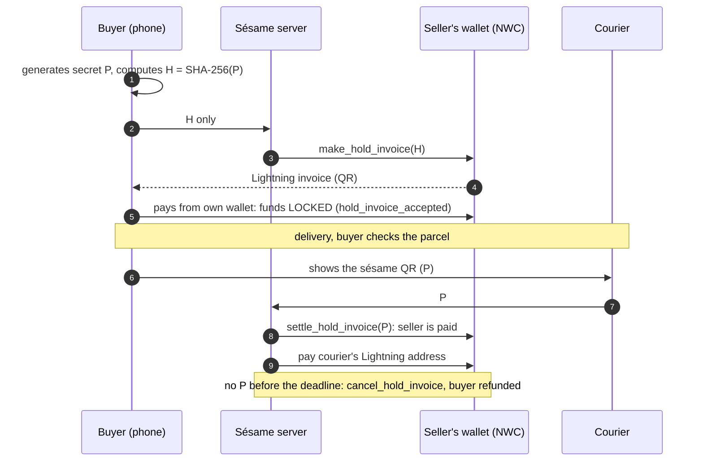

# Sésame

**Cash on delivery, without the cash and without fake payment screenshots.**

*[Version française](README.fr.md)*

In Senegal and Benin, a lot of retail happens on WhatsApp, Instagram and TikTok, but nobody trusts anybody. Buyers won't pay upfront for fear of receiving nothing. Sellers get fake Mobile Money screenshots and orders cancelled at the door. Couriers carry cash. Sésame fixes this: **the buyer pays before delivery, the money stays locked, and it is only released when the buyer, parcel in hand, shows their "sésame" (a secret QR code) to the courier.** If nothing is delivered in time, the buyer is refunded automatically.

Underneath, the lock is a **Bitcoin Lightning hold invoice**: during delivery, nobody can take the money, not even Sésame.

> Submitted to the **Dakar Bitcoin Hack 2026 by Btrust**.
> **Live demo:** https://sesame-1j54.onrender.com (tap "Essayer les 3 rôles en 2 minutes": all three roles, no account). Free hosting: the first load can take about a minute.
> **Demo video (3 min):** see the Devpost page.
> The app interface is in **French**, the language of our users in Senegal and Benin. The code, docs and pitch are in English.

## Who does what

| Actor | What they do | Account? |
|---|---|---|
| **Seller** | Pastes the WhatsApp conversation (the order fills itself in), sends the payment link, then the delivery mission. Connects **her own Lightning wallet** (Nostr Wallet Connect). | Yes (shop + PIN) |
| **Buyer** | Opens the link and pays from **their own Lightning wallet** (Mobile Money coming via an exchange partner). On delivery, checks the parcel, then shows the sésame. | No: a WhatsApp link |
| **Courier** | Opens the mission link, sees the buyer has already paid, scans the sésame, gets paid instantly to his Lightning address. | No: a WhatsApp link |
| **Admin** | Monitors activity, alerts and the audit log; can suspend a shop. **Can never touch the money.** | Access code |

## How it works



More: [docs/ARCHITECTURE.md](docs/ARCHITECTURE.md).

## Real Lightning wallet integration (not simulated)

- **The seller connects her own wallet** with **Nostr Wallet Connect** (NIP-47), e.g. Alby Hub: paste or scan a `nostr+walletconnect://` code in "Mon wallet Lightning". Sésame checks the wallet supports hold invoices, then stores the code **encrypted**.
- **Hold invoices are created, settled and cancelled in HER wallet** (`make_hold_invoice`, `settle_hold_invoice`, `cancel_hold_invoice`, `hold_invoice_accepted` notification, with polling as a fallback). The money lands in her wallet, never with Sésame.
- **The buyer pays from any Lightning wallet** by scanning the QR.
- **The courier is paid** from the seller's wallet to his Lightning address (LNURL-pay).
- **Verified live on 15 November 2026** with free test wallets running on a real Alby Hub ([faucet.nwc.dev](https://faucet.nwc.dev)): payment locked, settled with the sésame (seller received the sats), and full refund on cancel. Reproduce it: `npm run nwc:check`, `npm run nwc:check -- --cancel`, `npm run nwc:e2e -- http://127.0.0.1:8080`.

## Run it in one command

Requirements: **Node.js 22.13+** (no Docker, no database to install).

```bash
npm run demo        # installs, builds, starts on http://127.0.0.1:8080
```

Seed data included:
- **Guided demo of the three roles:** home page, "Essayer les 3 rôles" button (throwaway shop, simulated payments).
- **Seller space:** `/v`, shop `pagnes-de-fifame`, PIN `2026` (set `SESAME_DEMO_PIN` to change it).
- **Public verifiable reputation:** `/verify/pagnes-de-fifame`.
- **Admin:** `/admin`, enabled by setting `SESAME_ADMIN_CODE` (8+ characters).

### With a real Lightning wallet (free test sats)

1. Get a free test wallet at https://faucet.nwc.dev (it runs on a real Alby Hub): you receive a `nostr+walletconnect://…` code.
2. Seller space → **Mon wallet Lightning** → paste the code. The wallet is checked (hold invoice support) and connected.
3. Create an order: the hold invoice is created **in that wallet**. Pay it from another Lightning wallet (a second faucet wallet, or your own).
4. Release with the sésame: the sats arrive in the seller's wallet. No delivery: cancel, the payer is refunded.

Other commands: `npm test` (122 tests), `npm run typecheck`, `npm run dev:server` + `npm run dev:web`. Configuration: [.env.example](.env.example). Free deployment (Render or Oracle Cloud): [docs/DEPLOIEMENT.md](docs/DEPLOIEMENT.md) (French).

## Status (honest)

| Component | Status |
|---|---|
| Sésame protocol (P/H), CFA franc ↔ msat amounts, state machine, escrow engine | ✅ tested |
| API, real-time updates (SSE), SQLite (encrypted secrets), hash-chained audit log | ✅ tested |
| Mobile web app: seller, buyer, courier, guided demo, admin | ✅ full flow checked (360 and 412 px wide) |
| **Seller's Lightning wallet via Nostr Wallet Connect, real hold invoices** | ✅ tested with the real NIP-47 protocol and **verified live** on Alby Hub |
| Signed Nostr receipts + reputation page verified in the browser | ✅ tested |
| Order autofill from a WhatsApp conversation (local rules, optional free LLM) | ✅ tested |
| Mobile Money payment and seller payout | 🟡 **simulated** (target partner: Banxaas, no public API yet) |
| Shops without a connected wallet, guided demo | 🟡 simulated wallet, labelled on screen |

## Constraints and known limits

- **Mobile Money ↔ bitcoin conversion** requires a licensed partner in each WAEMU country. Sésame does not do it itself. Banxaas covers Senegal, Côte d'Ivoire, Cameroon and Guinea, **not Benin yet**.
- **Hold invoices tie up Lightning liquidity**, so the delivery window is capped at 12 hours.
- **NWC hold invoices** are a NIP-47 extension (proposal) supported by Alby Hub; few wallets support it today.
- **To pay the courier, the seller authorises payments** in her wallet: Sésame can then spend within the **budget** she sets (recommended in the UI).
- **The 1% fee is accounted for but not yet collected** on real-wallet orders.
- **Disputes after delivery** (faulty product) are not covered in V1: the buyer checks before showing the sésame.
- **Free hosting (Render):** sleeps after 15 minutes, data reset on restart.

## Metrics to track

| Metric | Why |
|---|---|
| Weekly active sellers, orders per seller | Real adoption |
| Payment rate (paid orders / links sent) | Do buyers accept paying upfront? |
| Successful delivery rate (released / released + refunded) | Promise kept |
| Median time from payment to release | Delivery speed |
| Mobile Money vs Lightning share | Partner dependency |
| Failed payouts, overdue refunds | Reliability (admin alerts) |
| Load time on 3G, app size (about 36 KB gzipped JS) | Access on entry-level phones |

**Target reach (hypothesis to validate):** 20 pilot sellers in Dakar and Cotonou, 10 orders each per week: 200 cashless deliveries per week after three months.

## Next iteration

1. Mobile Money through a licensed exchange partner (Banxaas), then Benin with a local partner.
2. Pilot with 5 to 10 real sellers, tracking the metrics above.
3. Direct LND adapter for sellers running their own node.
4. Diaspora: pay from abroad for a delivery back home.

## Security

Full threat model: [docs/SECURITY.md](docs/SECURITY.md). In short:
- The sésame is generated on the buyer's phone and sent only once, at release.
- **Safe by default:** any failure, lost sésame or inaction ends in a refund.
- Validated inputs (Zod), hashed tokens, scrypt PINs, secrets, phone numbers and NWC codes encrypted at rest (AES-256-GCM), rate limits.
- No personal data or secrets in logs; the audit log rejects secrets and detects tampering.
- Strict security headers (CSP with no external or inline scripts).

## AI, transparently

By default, order autofill uses **local rules** (free, offline). With a free key (Groq or Google Gemini), an LLM is used, falling back to the local rules on error. Phone numbers are masked before anything is sent, and the AI never touches payments.

## Documentation

- [Architecture and protocol](docs/ARCHITECTURE.md)
- [Security and threat model](docs/SECURITY.md)
- [Devpost submission text](docs/DEVPOST.md)
- French: [README](README.fr.md), [sécurité](docs/SECURITE.md), [déploiement](docs/DEPLOIEMENT.md), [pitch](docs/PITCH.md)

## License

MIT
