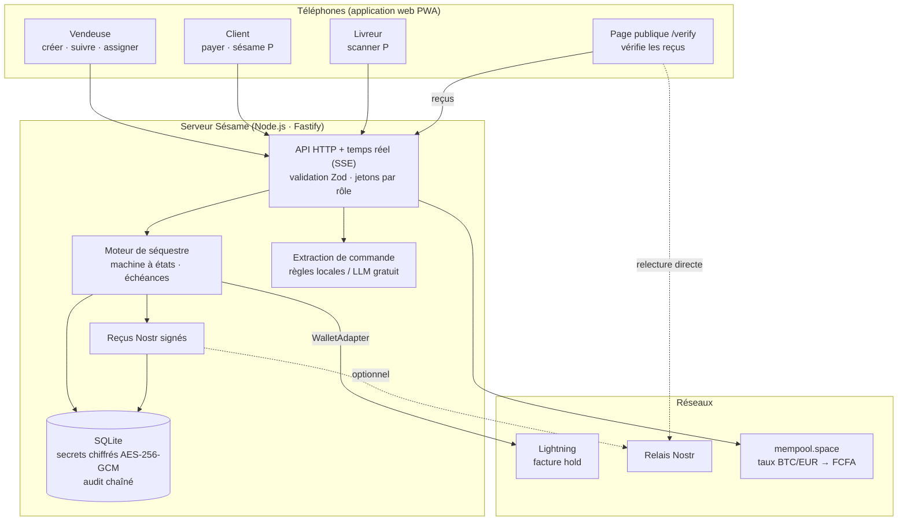
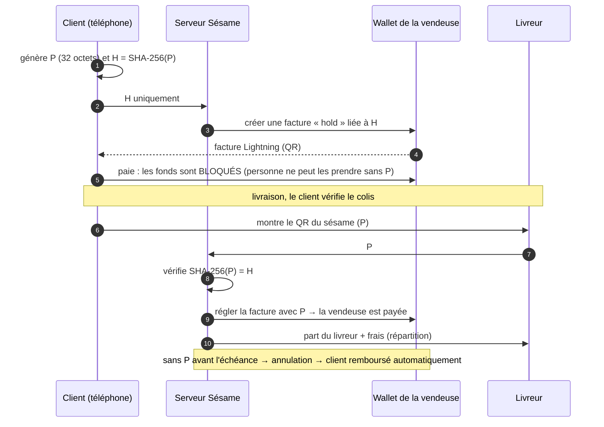
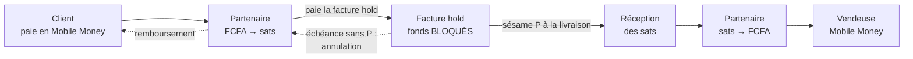

# Architecture de Sésame

## Vue d'ensemble

## Le protocole en une figure

## Choix et contraintes

| Sujet | Choix | Pourquoi |
|---|---|---|
| Garde des fonds | Aucune pendant la livraison | Le serveur ne détient aucune clé capable de dépenser l'argent bloqué ; il ne connaît P qu'au moment de la libération. |
| Sûr par défaut | Toute panne mène au remboursement | Perte du sésame, serveur arrêté, wallet injoignable : l'échéance rembourse le client. |
| Front-end | Preact + Vite, PWA | ≈ 30 Ko de JavaScript compressé côté client : adapté à la 3G et aux téléphones d'entrée de gamme. |
| Back-end | Node.js + Fastify + Zod | Un seul langage (TypeScript) partout ; validation stricte de toutes les entrées. |
| Base de données | SQLite intégrée à Node (`node:sqlite`) | Gratuite, aucune dépendance native ni administration. |
| Secrets au repos | AES-256-GCM | Sésame en attente et clés Nostr chiffrés ; jetons d'accès seulement hachés ; PIN en scrypt. |
| Réputation | Reçus Nostr (NIP-78) signés par la boutique | Vérifiables par n'importe qui, dans le navigateur, sans faire confiance au serveur. |
| IA | Règles locales + LLM gratuit facultatif | Fonctionne sans clé ni coût ; numéros de téléphone masqués avant tout envoi. |

## Mobile Money en façade, Lightning en arrière-plan

Presque aucun client ni vendeuse n'a de wallet Lightning en Afrique de l'Ouest ; tout le monde a un compte Mobile Money. Sésame passe donc par un **partenaire de change agréé** (partenaire visé : Banxaas) :

Dans la démonstration, le partenaire est simulé (route `POST /api/orders/:id/pay/momo`, remplacée en production par le webhook du partenaire). Le numéro Mobile Money de la vendeuse est chiffré ; une commande ne garde que « opérateur + 2 derniers chiffres ».

### Qui reçoit les sats

Pendant la livraison, les sats ne sont dans le wallet de personne : ils sont bloqués en transit sur le réseau, entre le wallet qui paie (le partenaire, approvisionné par le Mobile Money du client) et celui qui a créé la facture. Ce dernier peut être :

| Option | Garde des fonds | État |
|---|---|---|
| **A. Le partenaire** crée la facture hold pour le compte du numéro de la vendeuse | Sésame ne touche jamais l'argent | À confirmer avec Banxaas |
| **B. Un nœud Lightning de Sésame**, puis versement immédiat vers le Mobile Money | Sésame détient les sats quelques secondes à la libération | Faisable tout de suite, cadre réglementaire à prévoir |
| **C. Le wallet Lightning de la vendeuse** (factures hold via Nostr Wallet Connect) | Personne : l'argent arrive dans son wallet | **Implémenté** (« Mon wallet Lightning ») |

Dans tous les cas, **pendant la livraison, personne ne peut prendre l'argent bloqué, pas même Sésame.**

## Limites connues (état actuel)

- **Paiements simulés** dans la démonstration (bandeau « Démonstration »). L'adaptateur LND pour de vrais paiements sur réseau de test est la prochaine étape.
- **Mobile Money simulé** en attendant l'API partenaire de Banxaas ; le Bénin n'est pas encore couvert par Banxaas.
- Pas d'arbitrage en cas de litige après livraison (produit défectueux) : prévu en V2.
