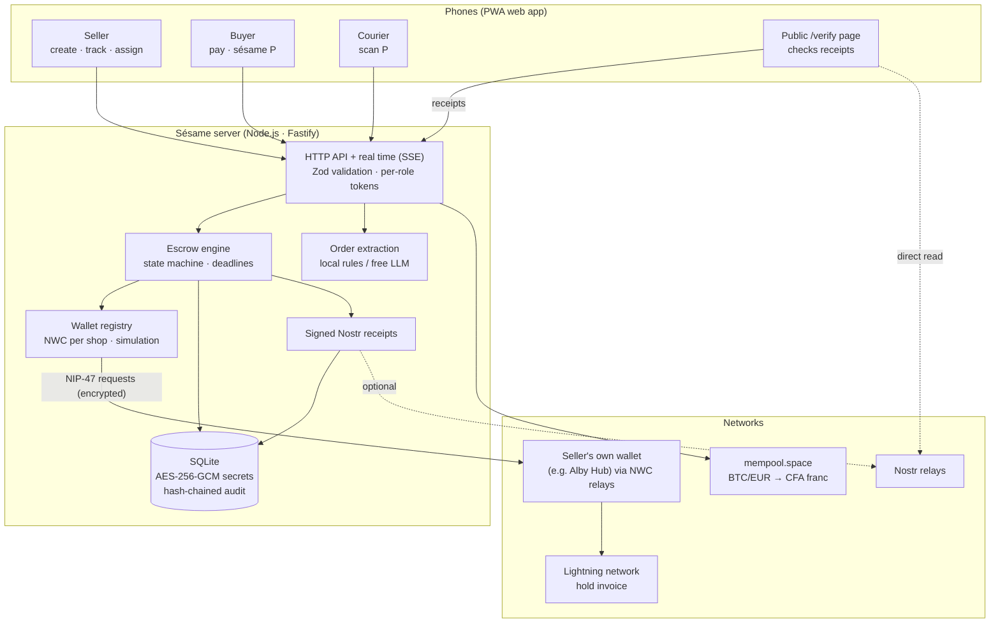
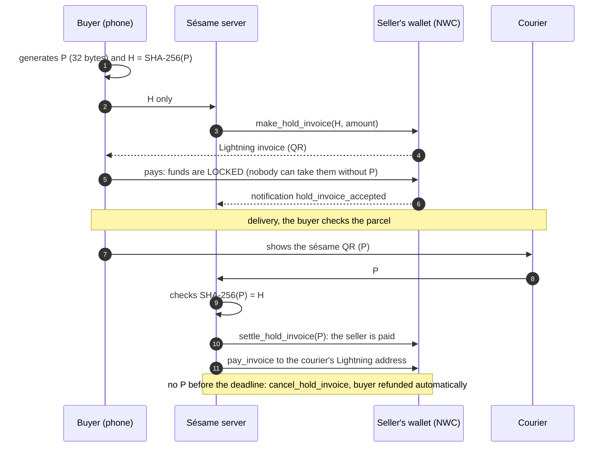
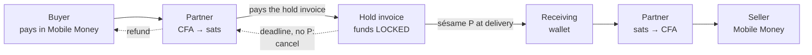

# Sésame architecture

*[Version française](ARCHITECTURE.fr.md)*

## Overview

## The protocol in one figure

## Wallets

Each shop gets a `WalletAdapter` with four operations: create, settle, cancel and look up a hold invoice.

| Implementation | When | Notes |
|---|---|---|
| `NwcHoldWallet` (Nostr Wallet Connect, NIP-47) | The seller connected her wallet ("Mon wallet Lightning") | Requests signed with the connection key, encrypted with NIP-44 (or NIP-04). `hold_invoice_accepted` notifications, plus polling with `lookup_invoice` as a fallback. Courier paid via LNURL-pay + `pay_invoice`. Verified live on Alby Hub. |
| `MemoryHoldWallet` (simulation) | Guided demo, shops without a wallet | Reproduces the hold invoice lifecycle; labelled "Démonstration" on screen. |

Each order records which wallet holds its invoice (`walletKind`), so a simulated payment can never be applied to a real order.

## Mobile Money on the front, Lightning underneath

Almost no buyer or seller in West Africa has a Lightning wallet; everyone has Mobile Money. The plan is to go through a **licensed exchange partner** (target: Banxaas):

In the demo, the partner is simulated (`POST /api/orders/:id/pay/momo`, to be replaced by the partner's webhook). The seller's Mobile Money number is encrypted; an order only keeps "operator + last 2 digits".

### Who receives the sats

During delivery, the sats are in nobody's wallet: they are locked in transit on the network, between the paying wallet and the wallet that created the invoice. The latter can be:

| Option | Custody | Status |
|---|---|---|
| **A. The exchange partner** creates the hold invoice on behalf of the seller's number | Sésame never touches the money | To confirm with Banxaas |
| **B. A Sésame Lightning node**, then an immediate Mobile Money payout | Sésame holds the sats for a few seconds at release | Feasible now, needs a regulatory framework |
| **C. The seller's own Lightning wallet** (hold invoices via Nostr Wallet Connect) | Nobody: the money lands in her wallet | **Implemented** ("Mon wallet Lightning") |

In every case, **during delivery nobody can take the locked money, not even Sésame.**

## Choices and constraints

| Topic | Choice | Why |
|---|---|---|
| Custody | None during delivery | The server holds no key able to spend the locked money; it only learns P at release. |
| Safe by default | Every failure ends in a refund | Lost sésame, server down, unreachable wallet: the deadline refunds the buyer. |
| Front end | Preact + Vite, PWA | About 36 KB of gzipped JavaScript for the main bundle: suited to 3G and entry-level phones. |
| Back end | Node.js + Fastify + Zod | One language (TypeScript) everywhere; strict validation of every input. |
| Database | SQLite built into Node (`node:sqlite`) | Free, no native dependency, no administration. |
| Secrets at rest | AES-256-GCM | Pending sésames, Nostr keys, NWC codes and phone numbers encrypted; access tokens only stored hashed; PINs with scrypt. |
| Reputation | Nostr receipts (NIP-78) signed by the shop | Verifiable by anyone, in the browser, without trusting the server. |
| AI | Local rules + optional free LLM | Works with no key and no cost; phone numbers masked before anything is sent. |

## Known limits (current state)

- **Mobile Money is simulated** pending Banxaas's partner API; Benin is not covered by Banxaas yet.
- **Shops without a connected wallet** and the guided demo use the simulated wallet.
- No arbitration for disputes after delivery (faulty product): planned for V2.
