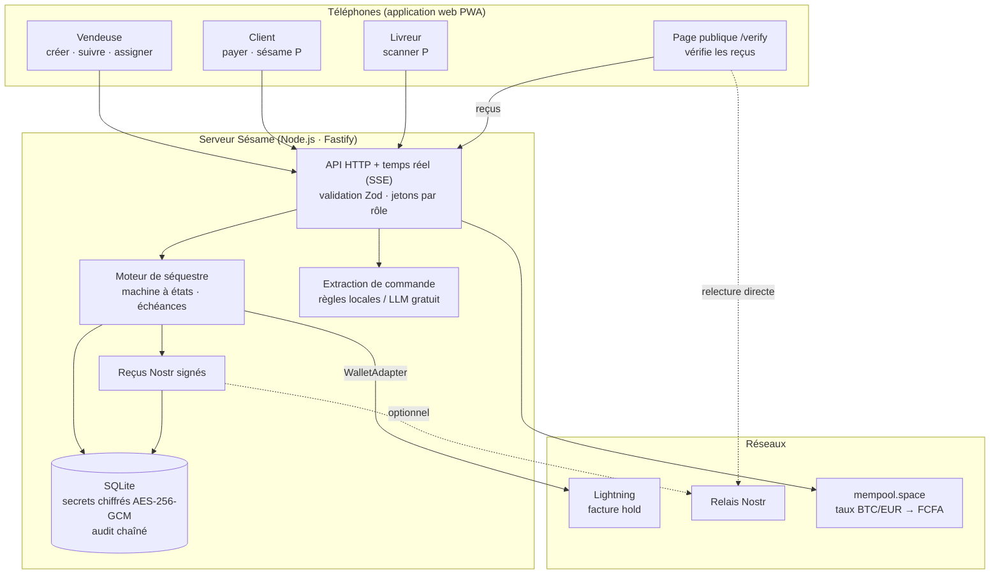
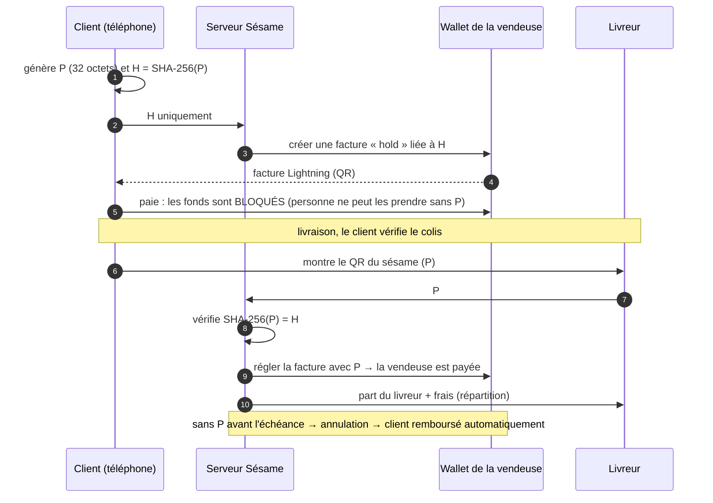

# Architecture de Sésame

## Vue d'ensemble

## Le protocole en une figure

## Choix et contraintes

| Sujet | Choix | Pourquoi |
|---|---|---|
| Garde des fonds | Aucune (non-custodial) | Le serveur ne détient aucune clé capable de dépenser l'argent du client ; il ne connaît P qu'au moment de la libération. |
| Sûr par défaut | Toute panne mène au remboursement | Perte du sésame, serveur arrêté, wallet injoignable : l'échéance rembourse le client. |
| Front-end | Preact + Vite, PWA | ≈ 30 Ko de JavaScript compressé côté client : adapté à la 3G et aux téléphones d'entrée de gamme. |
| Back-end | Node.js + Fastify + Zod | Un seul langage (TypeScript) partout ; validation stricte de toutes les entrées. |
| Base de données | SQLite intégrée à Node (`node:sqlite`) | Gratuite, aucune dépendance native ni administration. |
| Secrets au repos | AES-256-GCM | Sésame en attente et clés Nostr chiffrés ; jetons d'accès seulement hachés ; PIN en scrypt. |
| Réputation | Reçus Nostr (NIP-78) signés par la boutique | Vérifiables par n'importe qui, dans le navigateur, sans faire confiance au serveur. |
| IA | Règles locales + LLM gratuit facultatif | Fonctionne sans clé ni coût ; numéros de téléphone masqués avant tout envoi. |

## Limites connues (état actuel)

- **Paiements simulés** dans la démonstration (bandeau « DÉMO » à l'écran). L'adaptateur LND pour de vrais paiements est la prochaine étape.
- Pas d'arbitrage en cas de litige après livraison (produit défectueux) : prévu en V2.
- Le client doit disposer de sats : l'achat en Mobile Money passera par une plateforme partenaire.
